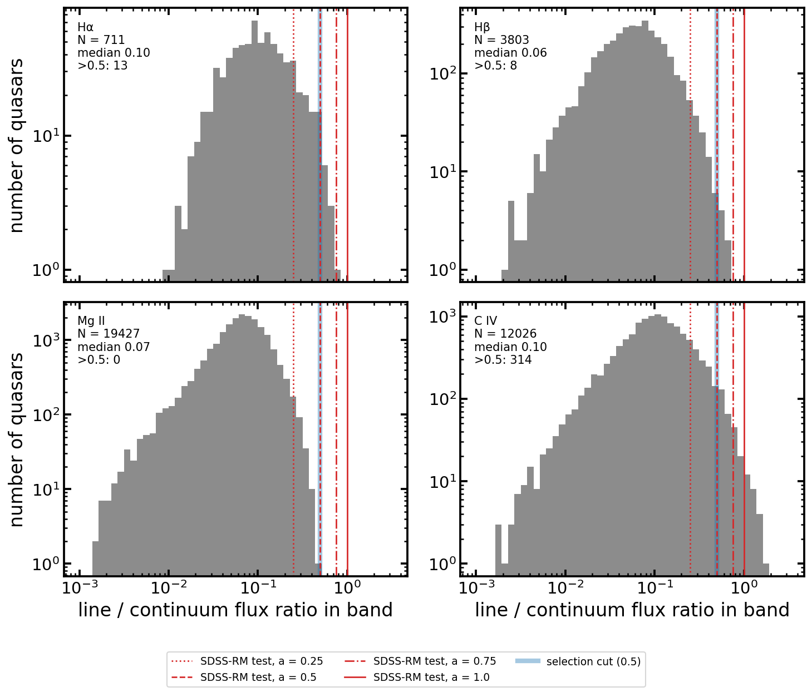

# SDSS-RM Hβ lags with EzTaoX

These scripts measure Hβ reverberation lags from the public SDSS-RM light curves with a Gaussian-process model of
the continuum and the broad-line response. They also test how well the lag is recovered when the line is blended
with the continuum in one band, as in photometric reverberation mapping.

## Installation

The broad-line model, `MixedBLRKernel`, is not in a released EzTaoX yet. Install EzTaoX from the `mixed-blr-kernel`
branch ([LSST-AGN-Variability/EzTaoX#151](https://github.com/LSST-AGN-Variability/EzTaoX/pull/151)). The kernel
also needs the GitHub version of `tinygp`.

```bash
pip install "git+https://github.com/burke86/EzTaoX@mixed-blr-kernel"
pip install -U "git+https://github.com/dfm/tinygp"   # after EzTaoX, which may install a released tinygp
pip install "equinox<0.13" astropy scipy pandas matplotlib
```

- EzTaoX currently imports `equinox._module.BoundMethod`, which equinox 0.13 removed, so use `equinox<0.13`.
- Tested with jax 0.6.2, tinygp 0.3.2.dev17 and equinox 0.12.2. EzTaoX's `pyproject.toml` pins `jax==0.4.31`. If
  you already have a working jax installation, install EzTaoX with `--no-deps` to keep it.

## Data

The light curves are not included. Download them from the
[SDSS-RM final-result release](https://ariel.astro.illinois.edu/sdssrm/final_result/) (Shen et al. 2024, ApJS,
272, 26):

```bash
python download_sdssrm.py            # summary.fits + continuum and Hβ light curves of quasars with an Hβ lag
```

This writes `summary.fits` and `rmXXX/cont_lc.txt` and `rmXXX/hb_lc.txt`.
- `cont_lc.txt` is the merged continuum: MJD, flux density, error, and facility.
- `hb_lc.txt` is the Hβ light curve: MJD, flux, error.

Use `--all` for every object and `--lines` for other broad lines.

## Running

1. **Synthetic photometric bands.** Each band point pairs an SDSS-RM Hβ flux with a photometric continuum
   point (Bok, CFHT, PS1 or ZTF) taken within 1 day of that spectrum. Its value is 1 + (δC + a δHβ)/(1 + a).
   Here δ = flux/median − 1, and `a` is the Hβ/continuum flux ratio. Nothing is interpolated.

   ```bash
   python generate_synthetic_hbeta_prm.py --amplitudes 1.0 0.75 0.5 0.25
   ```

   This writes `synthetic_hbeta_prm/rmXXX/prm_hb_a<amp>_lc.txt`. It deletes and rewrites the files it created
   there, so list every amplitude you want in one call.
   - The continuum part of the band comes from imaging, as in a real broad-band survey.
   - For these cases the continuum channel leaves out the photometric points used in the bands and the
     spectroscopic continuum (`sdss_spec`), so the two channels share no measurements or noise.
   - Don't build the band from the spectroscopic continuum. Season to season it differs from the photometric
     continuum by a few percent, and rm177 then came out at about 600 days, against 17 days with the
     photometric continuum (SDSS-RM: 22 days).

2. **Job list:** quasars with an SDSS-RM Hβ lag of grade ≥ 4, one line per object and case:

   ```bash
   python make_jobs.py jobs.txt --cases a1 a0p75 a0p5 a0p25      # add "spec" for the Hβ light curve itself
   ```

3. **Fits**, three at a time (finished fits are skipped, so the run can be restarted):

   ```bash
   sh run_lag_profiles.sh jobs.txt runs/run1 3
   ```

   A single fit is `python rm_lag_profile.py <rmid> <case> <out_dir> [--order K]`.

4. **Recovery summary and plot:**

   ```bash
   python analyze_lag_recovery.py runs/run1     # summary.csv and lag_recovery.pdf
   ```

## Model

`rm_lag_profile.py` fits two channels:
- channel 0, the continuum;
- channel 1, the Hβ light curve (case `spec`) or a synthetic band (case `a<amp>`).

The model has these parts:

- **Kernel:** a damped-random-walk driver x(t) and an Erlang broad-line response ψ (`MixedBLRKernel`, order
  K = 3 by default). Each channel is `c x(t) + r (ψ * x)(t)`. The Hβ channel of `spec` has no continuum term.
- **Noise and means:** one jitter per (channel, facility) group, with the facility (telescope + filter) taken
  from the continuum file. There is one mean per channel and one linear trend.
- **Known continuum fraction:** a synthetic band's continuum fraction is 1/(1 + a), which in practice comes from
  the spectrum (line equivalent width and filter curve). The band's prompt-continuum amplitude gets a log-normal
  prior centered there, 10% wide (`CONT_FRAC_PRIOR_WIDTH`).
  - Without this prior, a short echo is nearly indistinguishable from the prompt continuum. The broad-line term
    then fits slow Hβ variations instead, at lags near the baseline. rm303 came out at about 950 days against
    24.5.
- **Lag posterior:** the profile likelihood over 24 rest-frame lags (2–900 days), times a log-normal lag prior
  centered at 100 days. At each lag the other parameters are maximized.

Each fit writes a JSON file to `<out_dir>/out/`. It contains:
- the lag grid, the posterior and the prior-divided likelihood;
- the 16/50/84% rest-frame lags (`q_post_rest`);
- posterior peaks and multimodal/edge flags;
- the SDSS-RM reference lag;
- the best-fit parameters at each lag.

A fit takes about 30–60 seconds and 0.1–1 GB of memory on a laptop CPU.

## Caveats

- **Synthetic bands are sparse.** Only spectra with photometry within a day give a band point: about 40 per
  object (20–45), from 2014 to 2020. A real broad-band survey samples the line at every photometric epoch.
- **The test lines are strong.** In survey photometry the in-band line/continuum ratio is typically 0.05–0.1,
  below the weakest case here. The histograms show this ratio for about 23,000 variable Stripe 82 quasars, in
  each line's strongest SDSS band. The ratios come from DR16Q broad-line equivalent widths and the SDSS filter
  curves. The red lines mark the ratios tested here, and the blue line is a 0.5 selection cut. Only C IV has
  many quasars above 0.5; Hβ has 8 and Mg II none.

  

## References

- SDSS-RM data: Shen et al. 2015, ApJS, 216, 4; Shen et al. 2024, ApJS, 272, 26
- EzTaoX: Yu et al. 2026, ApJ, 998, 144
